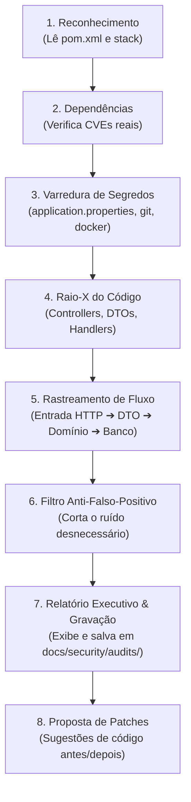

# 🛡️ Guia Descomplicado da Skill `security-audit`
*Tudo o que você precisa saber sobre o que ela é, por que ela existe e como ela protege nosso projeto — explicado de dev para dev.*

---

## ☕ O que diabos é uma "Skill"?

Se você já usou IA para programar, com certeza já passou por isso:
> Você abre o chat e pergunta: *"Meu código tá seguro?"*  
> A IA te responde uma lista genérica de 10 mandamentos teóricos da internet, inventa que uma função do Java tá vulnerável sem nem saber qual versão você usa, sugere instalar três ferramentas pagas ou simplesmente diz que *"está tudo ótimo"* sem olhar como os dados passam do controller para o banco.

**Uma Skill é o antídoto para isso.**

Pense na Skill como um **manual de operações cirúrgico** que você entrega para a IA antes de ela olhar para o seu projeto. Em vez de agir como um robô genérico que chuta respostas com base na média da internet, a IA "veste o chapéu" de um **Especialista em Segurança de Software Sênior**, focado exclusivamente na sua arquitetura, com regras estritas do que olhar, do que ignorar e de como te entregar o resultado.

---

## 🤔 Por que precisamos dessa Skill no nosso projeto?

Nosso projeto (`concessionaria`) é uma API real em **Java 21 + Spring Boot 3.3.4 + MySQL + Flyway**, que no futuro terá um painel em **React**.

Em segurança de software, existem três grandes problemas quando analisamos código:

1. **O perigo do "Falso Positivo" (Ruído que faz você perder tempo):**
   Ferramentas comuns de scan costumam gritar alertas vermelhos para coisas inofensivas. Por exemplo: *"Você não colocou autenticação no Swagger local!"* ou *"Esse método `findByAno` pode ser injeção de SQL!"*.  
   A skill ensina a IA que, no nosso caso, o Swagger é local de desenvolvimento e que o Spring Data JPA parametriza as buscas nativamente. **Sem alarmes falsos idiotas.**

2. **A cegueira de versão (Olhar para o que não existe):**
   Muitas IAs criticam código antigo em projetos modernos ou criticam código moderno achando que é antigo. A nossa skill obriga a IA a abrir o `pom.xml`, ver que estamos no **Spring Boot 3.3.4 com Java 21**, e avaliar as coisas com base nas regras do Spring 3 (como o pacote `jakarta.*` e o novo `Problem Details` da RFC 7807), não no Spring Boot 1 ou 2 de dez anos atrás.

3. **Segurança de verdade (Nenhum código é alterado na surdina):**
   A skill tem uma regra de ouro: **ela jamais altera o código do projeto diretamente**. Se ela encontrar um furo grave, ela te mostra o diagnóstico e gera um patch no estilo `diff` (antes e depois). Você revisa, concorda e decide se quer aplicar. Controle 100% na sua mão.

---

## ⚙️ Como a Skill Funciona por Baixo do Capô?

Quando você roda a skill (digitando `/security-audit`), a IA segue um ritual de **8 passos ordenados**, agindo como um perito:



### Passo 1: O Reconhecimento (Stack Detectado)
A IA não adivinha. Ela abre o `pom.xml` (ou `package.json` no frontend) e anota:
* "Eles estão usando Java 21 e Spring Boot 3.3.4."
* "Usam ModelMapper 3.2.1, SpringDoc 2.6.0 e Flyway."

### Passo 2: Checagem de Dependências
Ela inspeciona as bibliotecas instaladas em busca de versões com falhas conhecidas de segurança (CVEs).

### Passo 3: Caça aos Segredos
Ela procura senhas esquecidas, chaves de API ou arquivos perigosos que subiram para o Git por engano (`.env`, certificados, credenciais de produção).  
*Detalhe esperto:* ela sabe que a senha `root` no `docker-compose.yml` da sua máquina local não é um ataque em produção, então ela não entra em pânico.

### Passo 4 e 5: O Rastreamento de Fluxo (Taint Analysis)
Aqui é onde a mágica acontece. A IA segue o caminho que a requisição faz:
1. O usuário manda um JSON no `POST /carros`.
2. O `@RequestBody` tem anotação `@Valid`?
3. O DTO de entrada (`CarroInput`) permite que alguém envie um `id` falso ou force uma `dataCompra` do passado? *(Mass Assignment)*.
4. O `CarroInputDisassembler` limpa esses campos antes de salvar no banco?
5. Se der erro no banco, o `ApiExceptionHandler` cospe o erro cru do MySQL na tela do usuário revelando nomes de tabelas, ou entrega uma mensagem limpa e elegante?

### Passo 6: O Pente-Fino Anti-Falso-Positivo
Antes de montar o relatório, a IA confere a lista de "coisas que parecem erro mas não são" em `refs/false-positives.md`. Se ela ia reclamar de algo que é intencional ou seguro por design, ela joga fora ou rebaixa para **INFO**.

### Passo 7 e 8: Entrega Mastigada com Solução e Gravação Automática
Ela monta um relatório claro e **sempre grava um arquivo `.md` na pasta `docs/security/audits/`** (ex: `2026-10-02-auditoria.md`):
* **Tabela de Severidade:** quantas falhas Críticas, Altas, Médias ou Baixas existem.
* **Histórico Permanente:** você pode abrir os relatórios passados e acompanhar a evolução.
* **Código de correção:** bloco de código mostrando exatamente como consertar.

---

## 🎯 Onde essa Skill Fica Guardada?

Ela mora no próprio repositório, na pasta:
```text
C:\Projetos\concessionaria\.agents\skills\security-audit\
```
Isso significa que qualquer pessoa ou nova instância de IA que abrir esse projeto no futuro terá acesso imediato a essa inteligência de segurança padronizada.

---

## 📁 Onde os Relatórios Ficam Salvos?

Ficam salvos em:
```text
docs/security/audits/YYYY-MM-DD-auditoria.md
```
Assim todo relatório gerado vira documentação permanente e versionada no Git!

---

## 💡 Como Chamar a Skill?

Basta falar com a IA de forma natural:
* `/security-audit`
* *"Rode a skill de segurança no projeto"*
* *"Verifique a segurança do pacote api"*
