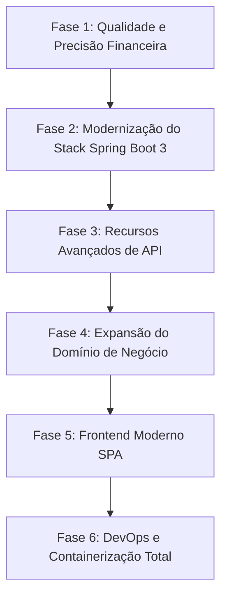

# 🚀 Roadmap de Evolução e Melhorias — Concessionária Gomez API

Documento criado em **13/09/2026** consolidando o diagnóstico atual da aplicação e o plano de evolução técnica e de negócios para guiar as próximas etapas de desenvolvimento.

---

## 📌 Status Atual do Projeto (Baseline)
- [x] **Ambiente Local:** Java 21 + MySQL 8.0 rodando isolado via Docker (`docker-compose.yml` na porta `3307`).
- [x] **Gerenciador de Banco:** DBeaver Community conectado e operacional (porta `3307`).
- [x] **Framework:** Spring Boot 3.3.4 com Maven e Java 21 nativo.
- [x] **Documentação da API:** OpenAPI 3 / Swagger UI moderno via SpringDoc em `/swagger-ui/index.html`.
- [x] **Banco & Migrations:** Flyway gerenciando scripts com carga de testes automática (`afterMigrate.sql`).
- [x] **Testes de API:** Coleção Postman validada (`concessionaria-postman-collection.json`) com fluxo CRUD completo de Carros, Clientes, Vendas e Fotos, paginação, ordenação, Specifications, HATEOAS e suite de 46 testes unitários/integrados.
- [x] **Auditoria de Segurança:** Skill automatizada integrada (`.agents/skills/security-audit/`).

---

## 🗺️ Fases Sugeridas de Evolução

---

### 🔹 Fase 1: Qualidade de Código & Precisão Financeira (Quick Wins)
- [x] **Migração de `Double`/`double` para `BigDecimal`:**
  - Substituir tipos primitivos de ponto flutuante binário por `BigDecimal` nos campos de valor (`compra` e `venda`).
  - Evitar dízimas e imprecisões contábeis no arredondamento financeiro.
  - Migration Flyway `V004__altera-compra-para-decimal.sql` adicionada.
- [x] **Extração da Regra de Negócio de Venda:**
  - Mover o cálculo da margem de 10% de `CarroModel.java` (camada de apresentação/DTO) para o domínio (`Carro.java` ou `CalculadoraMargemService`).
  - Permitir parametrização futura da margem de lucro por veículo ou categoria.
- [x] **Revisão e Expansão dos Testes de Integração:**
  - Testes unitários (`CarroTest`, `CarroModelAssemblerTest`) validados.
  - Suite de testes de integração com REST-Assured em `CadastroCarroIT.java` expandida para cobrir 100% dos fluxos CRUD e regras de negócio:
    - `GET /carros` (listagem completa e contagem)
    - `GET /carros?ano={ano}` (filtro por ano)
    - `GET /carros/{id}` (sucesso e 404 para ID inexistente)
    - Validação de cálculo da margem sugerida de 10% no endpoint de busca
    - `POST /carros` (cadastro com sucesso 201 e validação de schema 400 Bad Request)
    - `PUT /carros/{id}` (atualização completa 200)
    - `PUT /carros/{id}/ativo` (ativação 204 No Content)
    - `DELETE /carros/{id}/ativo` (inativação 204 No Content)
    - `DELETE /carros/{id}` (exclusão física 204 No Content e validação 404)

---

### 🔹 Fase 2: Modernização do Stack Tecnológico & Blindagem de Atualizações
- [x] **Upgrade para Spring Boot 3.3.4 e Java 21:**
  - Migradas todas as dependências e anotações do ecossistema legado `javax.*` para `jakarta.*` (`jakarta.persistence`, `jakarta.validation`).
  - Atualizado `ApiExceptionHandler` para suportar `HttpStatusCode` do Spring 6.
  - Driver MySQL modernizado para `com.mysql:mysql-connector-j` e módulo `flyway-mysql` adicionado.
- [x] **Substituição do Springfox por SpringDoc (OpenAPI 3 / Swagger Moderno):**
  - Removido `springfox-swagger2` e `springfox-swagger-ui` (descontinuados).
  - Adicionado `springdoc-openapi-starter-webmvc-ui` (v2.6.0) para documentação viva e interativa em `/swagger-ui/index.html`.
  - Migradas anotações nos controllers (`@Tag`, `@Operation`) e configuração simplificada via bean `OpenAPI`.
- [x] **Atualização das dependências auxiliares e correções estruturais:**
  - `modelmapper` atualizado para versão `3.2.1` compatível com Java 21.
  - `lombok` atualizado para `1.18.34`.
  - Correção na atualização de veículos (`PUT`): implementado `copyToDomainObject` no `CarroInputDisassembler` com `setSkipNullEnabled(true)`, removido `@PreUpdate` indevido e blindado `dataCompra` contra mutações acidentais.
  - Teste unitário `CarroInputDisassemblerTest` implementado para garantir integridade das mesclagens.
- [x] **Skill de Auditoria de Segurança Automatizada (`security-audit`):**
  - Implementada em [`.agents/skills/security-audit/`](file:///C:/Projetos/concessionaria/.agents/skills/security-audit/README.md) adaptando as melhores práticas do framework Dev Fraga para Spring Boot 3, Java 21, JPA e Frontend React (Fase 5).
  - Inclui checklists de Spring Data JPA, Mass Assignment em DTOs, rastreamento de segredos, filtros anti-falso-positivo e geração de relatórios com patches sugeridos.

---

### 🔹 Fase 3: Recursos Avançados de API RESTful (100% Concluída)
- [x] **Filtros por Ano e Faixa de Valores (`minValor`, `maxValor` e BETWEEN):**
  - **O que foi feito:** Suporte a filtros numéricos combinados de ano e preço.
  - **Como funciona:** JPQL parametrizada flexível e 100% imune a SQL Injection.
  - **Validação e Testes:** Testes integrados com REST-Assured e requisições Postman.
- [x] **Paginação e Ordenação:**
  - **O que foi feito:** Endpoint `GET /carros` atualizado para receber `Pageable` com `@PageableDefault(size = 10)`.
  - **Como funciona:** Execução via `LIMIT` e `OFFSET` com `countQuery` dedicada, devolvendo metadados de total de registros e páginas.
  - **Validação e Testes:** Teste unitário em `CarroControllerTest`, testes em `CadastroCarroIT` e Postman.
- [x] **Filtros Dinâmicos Avançados com Specification (marca, modelo, ativo):**
  - **O que foi feito:** Implementado `JpaSpecificationExecutor<Carro>`, classe de especificação `CarroSpecs` e DTO `CarroFilter`.
  - **Como funciona:**
    - Consultas dinâmicas via *Criteria API*: cláusulas `WHERE` são geradas sob demanda apenas para os parâmetros preenchidos na URL.
    - Suporte a busca textual parcial e case-insensitive para `marca` (ex.: `?marca=merc`) e `modelo` (ex.: `?modelo=classe`).
    - Filtro booleano por status ativo (`?ativo=true` ou `false`).
    - Totalmente integrado à paginação e ordenação em uma única chamada.
  - **Validação e Testes:**
    - Teste unitário `CarroSpecsTest.java` com Mockito testando predicados dinâmicos e casos nulos.
    - Testes de integração em `CadastroCarroIT.java` e novas requisições 1.8 e 1.9 no Postman.
- [x] **Suporte a Quilometragem e Filtro por Range de KM (`minQuilometragem`, `maxQuilometragem` e regra `zeroKm`):**
  - **O que foi feito:** Adicionada a coluna `quilometragem` no banco via migration `V005__adiciona-quilometragem-em-carro.sql`, campo na entidade, DTOs de entrada e saída, regra de negócio `isZeroKm()` e filtros de range no `CarroSpecs`.
  - **Como funciona:**
    - Validação de entrada `@PositiveOrZero` garantindo que não existam valores negativos.
    - Regra de negócio na entidade para identificação automática de veículos 0 km.
    - Consultas com range de km (ex.: `?minQuilometragem=10000&maxQuilometragem=50000`).
  - **Validação e Testes:**
    - Testes unitários em `CarroTest`, `CarroInputTest`, `CarroInputDisassemblerTest` e `CarroSpecsTest`.
    - Teste de integração em `CadastroCarroIT` e requisição 1.10 no Postman.
- [x] **Maturidade REST com HATEOAS (Richardson Nível 3):**
  - **O que foi feito:** Adicionada a dependência `spring-boot-starter-hateoas` e implementado modelo hipermídia com `RepresentationModel`.
  - **Como funciona:**
    - O modelo `CarroModel` passa a carregar o nó `_links` guiando o cliente da API pelas ações disponíveis:
      - `self`: link direto para o próprio recurso (`GET /carros/{id}`);
      - `foto`: link direto para os metadados da foto do veículo (`GET /carros/{id}/foto`);
      - `carros`: link para voltar à coleção completa (`GET /carros`);
      - `inativar` / `ativar`: link dinâmico condicional que informa a ação de negócio válida para aquele carro específico de acordo com seu status atual.
  - **Validação e Testes:**
    - Teste unitário `CarroModelAssemblerTest.java` validando a geração dos links `self`, `foto`, `carros`, `inativar` e `ativar`.
    - Testes integrados em `CadastroCarroIT.java` verificando a presença de `_links`.

---

### 🔹 Fase 4: Expansão do Domínio de Negócio (100% Concluída)
- [x] **Módulo de Clientes:**
  - **O que foi feito:**
    - Migration Flyway `V006__cria-tabela-cliente.sql` com constraints e unicidade de CPF/CNPJ.
    - Carga inicial em `afterMigrate.sql` com clientes PF e PJ.
    - Entidade [`Cliente`](file:///C:/Projetos/concessionaria/src/main/java/com/concessionaria/gomez/domain/model/Cliente.java) e Value Object [`Endereco`](file:///C:/Projetos/concessionaria/src/main/java/com/concessionaria/gomez/domain/model/Endereco.java) embutido (`@Embedded`).
    - [`ClienteRepository`](file:///C:/Projetos/concessionaria/src/main/java/com/concessionaria/gomez/domain/repository/ClienteRepository.java) com `JpaSpecificationExecutor` e validação de duplicidade por CPF/CNPJ.
    - [`CadastroClienteService`](file:///C:/Projetos/concessionaria/src/main/java/com/concessionaria/gomez/domain/service/CadastroClienteService.java) com regras de negócio, ativação/inativação e exclusão protegida.
    - Exceção de domínio [`ClienteNaoEncontradoException`](file:///C:/Projetos/concessionaria/src/main/java/com/concessionaria/gomez/domain/exception/ClienteNaoEncontradoException.java).
    - DTOs de entrada e saída: [`ClienteInput`](file:///C:/Projetos/concessionaria/src/main/java/com/concessionaria/gomez/api/model/input/ClienteInput.java), [`EnderecoInput`](file:///C:/Projetos/concessionaria/src/main/java/com/concessionaria/gomez/api/model/input/EnderecoInput.java), [`ClienteModel`](file:///C:/Projetos/concessionaria/src/main/java/com/concessionaria/gomez/api/model/ClienteModel.java) e [`EnderecoModel`](file:///C:/Projetos/concessionaria/src/main/java/com/concessionaria/gomez/api/model/EnderecoModel.java).
    - [`ClienteModelAssembler`](file:///C:/Projetos/concessionaria/src/main/java/com/concessionaria/gomez/api/assembler/ClienteModelAssembler.java) com suporte completo a HATEOAS (`self`, `clientes`, `ativar`, `inativar`).
    - [`ClienteInputDisassembler`](file:///C:/Projetos/concessionaria/src/main/java/com/concessionaria/gomez/api/assembler/ClienteInputDisassembler.java) blindado para cópia de dados.
    - [`ClienteController`](file:///C:/Projetos/concessionaria/src/main/java/com/concessionaria/gomez/api/controller/ClienteController.java) com CRUD completo, paginação, ordenação e documentação OpenAPI 3.
- [x] **Módulo de Propostas / Vendas:**
  - **O que foi feito:**
    - Migration Flyway `V007__cria-tabela-venda.sql` associando `Carro` e `Cliente` com chaves estrangeiras.
    - Entidade [`Venda`](file:///C:/Projetos/concessionaria/src/main/java/com/concessionaria/gomez/domain/model/Venda.java) com data da venda automática via `@CreationTimestamp`.
    - Repositório [`VendaRepository`](file:///C:/Projetos/concessionaria/src/main/java/com/concessionaria/gomez/domain/repository/VendaRepository.java) com busca otimizada (`join fetch`).
    - Serviço de negócio [`EmissaoVendaService`](file:///C:/Projetos/concessionaria/src/main/java/com/concessionaria/gomez/domain/service/EmissaoVendaService.java) com regras críticas:
      - Impede venda de veículos inativos ou já vendidos (`NegocioException`).
      - Impede venda para clientes inativos.
      - **Inativação automática do veículo no estoque** ao concretizar a venda.
      - Cancelamento de venda com reativação automática do veículo no estoque.
    - DTOs [`VendaInput`](file:///C:/Projetos/concessionaria/src/main/java/com/concessionaria/gomez/api/model/input/VendaInput.java), [`VendaModel`](file:///C:/Projetos/concessionaria/src/main/java/com/concessionaria/gomez/api/model/VendaModel.java), [`CarroResumoModel`](file:///C:/Projetos/concessionaria/src/main/java/com/concessionaria/gomez/api/model/CarroResumoModel.java) e [`ClienteResumoModel`](file:///C:/Projetos/concessionaria/src/main/java/com/concessionaria/gomez/api/model/ClienteResumoModel.java).
    - [`VendaModelAssembler`](file:///C:/Projetos/concessionaria/src/main/java/com/concessionaria/gomez/api/assembler/VendaModelAssembler.java) com links HATEOAS (`self`, `vendas`, `carro`, `cliente`, `cancelar`).
    - [`VendaController`](file:///C:/Projetos/concessionaria/src/main/java/com/concessionaria/gomez/api/controller/VendaController.java) com listagem paginada, busca individual, emissão e cancelamento.
- [x] **Upload e Armazenamento de Fotos do Veículo:**
  - **O que foi feito:**
    - Migration Flyway `V008__cria-tabela-foto-carro.sql` vinculada à chave primária do carro.
    - Entidade [`FotoCarro`](file:///C:/Projetos/concessionaria/src/main/java/com/concessionaria/gomez/domain/model/FotoCarro.java) com `@MapsId` e metadados (`nomeArquivo`, `contentType`, `tamanho`, `descricao`).
    - Interface [`FotoStorageService`](file:///C:/Projetos/concessionaria/src/main/java/com/concessionaria/gomez/domain/service/FotoStorageService.java) e implementação local [`DiscoLocalFotoStorageService`](file:///C:/Projetos/concessionaria/src/main/java/com/concessionaria/gomez/infrastructure/service/storage/DiscoLocalFotoStorageService.java) desacoplada e preparada para substituição por S3/MinIO.
    - Configuração de storage via [`StorageProperties`](file:///C:/Projetos/concessionaria/src/main/java/com/concessionaria/gomez/core/storage/StorageProperties.java).
    - Serviço [`CatalogoFotoCarroService`](file:///C:/Projetos/concessionaria/src/main/java/com/concessionaria/gomez/domain/service/CatalogoFotoCarroService.java) que gerencia substituição e remoção de arquivos físicos e registros no banco com garantia transacional.
    - DTOs [`FotoCarroInput`](file:///C:/Projetos/concessionaria/src/main/java/com/concessionaria/gomez/api/model/input/FotoCarroInput.java) e [`FotoCarroModel`](file:///C:/Projetos/concessionaria/src/main/java/com/concessionaria/gomez/api/model/FotoCarroModel.java).
    - Controller [`CarroFotoController`](file:///C:/Projetos/concessionaria/src/main/java/com/concessionaria/gomez/api/controller/CarroFotoController.java) com suporte a:
      - `PUT /carros/{id}/foto` (upload multipart/form-data)
      - `GET /carros/{id}/foto` (metadados JSON com HATEOAS)
      - `GET /carros/{id}/foto` (serviço direto do binário da imagem JPEG/PNG com `InputStreamResource`)
      - `DELETE /carros/{id}/foto` (remoção da foto e do arquivo no disco)
- [x] **Qualidade & Testes Automatizados:**
  - Suite de testes expandida para **46 testes unitários e de integração com 100% de sucesso**.
  - Testes cobrindo validação de DTOs, cálculo financeiro, emissão de vendas, regras de inativação, upload/substituição de fotos e HATEOAS.
  - Coleção Postman atualizada com todas as pastas (`Carros`, `Fotos`, `Clientes`, `Vendas`).

---

### 🔹 Fase 5: Frontend Moderno (Painel do Funcionário)
- [ ] **Mockup de Interface (UI Concept):**
  - Visualização conceitual salva em [concessionaria-dashboard-ui.png](file:///C:/Projetos/concessionaria/concessionaria-dashboard-ui.png).
- [ ] **Tecnologia recomendada: React (Vite + TypeScript) ou Angular / Vue / Tailwind CSS:**
  - Interface SPA (Single Page Application) limpa, responsiva e com visual profissional.
- [ ] **Dashboard Principal:**
  - Total de veículos em estoque, valor total investido e estimativa de faturamento com margem.
- [ ] **Grid / Catálogo Interativo com Cards:**
  - Exibição visual de cada carro (marca, modelo, ano, crachá "Ativo/Inativo", valor sugerido de venda).
  - Ações rápidas: botão de alternar ativo/inativo, editar e excluir com modal de confirmação.
- [ ] **Formulário de Cadastro/Edição:**
  - Validação de campos em tempo real com mensagens amigáveis em português (consumindo o *Problem Details* do backend).

---

### 🔹 Fase 6: DevOps & Containerização Completa
- [ ] **Dockerfile Multi-Stage para o Spring Boot:**
  - Criação do `Dockerfile` otimizado para compilar e empacotar a aplicação em imagem leve (Alpine/Distroless).
- [ ] **Docker Compose Unificado:**
  - Expandir o `docker-compose.yml` para subir a aplicação Java + Frontend + MySQL juntos em um único comando `docker compose up -d` faz tudo.
- [ ] **CI/CD Básico (GitHub Actions):**
  - Pipeline automático para compilar, rodar testes e verificar qualidade a cada push.

---

## 🛠️ Como Consultar ou Executar
Quando for iniciar uma etapa, basta abrir este arquivo no projeto (`ROADMAP.md`), escolher a tarefa e iniciamos com commits pontuais e testes a cada passo!
