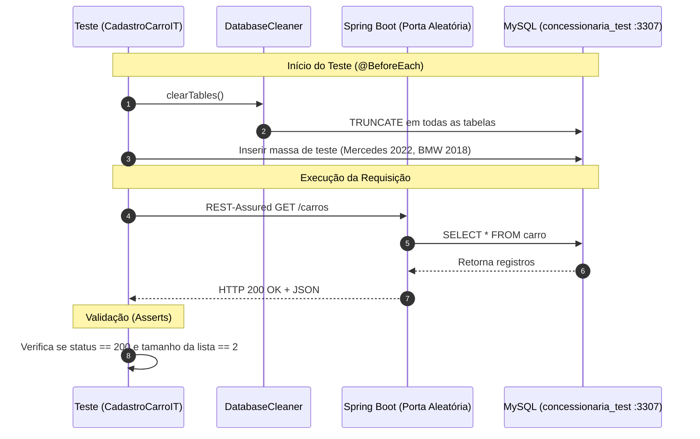

# 📚 Guia de Arquitetura, Decisões de Projeto e Conceitos — Concessionária Gomez

Este documento foi elaborado para servir como material de consulta permanente e estudo contínuo. Ele está formatado com sintaxe compatível com o **Obsidian** (incluindo *Callouts*, diagramas *Mermaid* e tabelas comparativas).

---

## 📑 Sumário
1. [Extração da Regra de Negócio de Venda (Domínio vs. DTO)](#1-extração-da-regra-de-negócio-de-venda-domínio-vs-dto)
2. [Arquitetura em Camadas: Controller, Model e Assembler](#2-arquitetura-em-camadas-controller-model-e-assembler)
3. [Roteamento HTTP no Spring: O Mistério do Erro 400 no Filtro de Ano](#3-roteamento-http-no-spring-o-mistério-do-erro-400-no-filtro-de-ano)
4. [Testes de Integração com REST-Assured e a Classe CadastroCarroIT](#4-testes-de-integração-com-rest-assured-e-a-classe-cadastrocarroit)
5. [Precisão Financeira: Por que BigDecimal e não Double?](#5-precisão-financeira-por-que-bigdecimal-e-não-double)
6. [Modernização de Plataforma: Spring Boot 3, Java 21 e SpringDoc](#6-modernização-de-plataforma-spring-boot-3-java-21-e-springdoc)

---

## 1. Extração da Regra de Negócio de Venda (Domínio vs. DTO)

### 📌 O Cenário Original
Anteriormente, o cálculo da margem de lucro de 10% da concessionária estava implementado dentro do getter de uma classe DTO (`CarroModel.java`):

```java
// ❌ ANTES: api/model/CarroModel.java (camada de apresentação)
public BigDecimal getVenda() {
    if (this.compra == null) return null;
    return this.compra.multiply(new BigDecimal("1.10")).setScale(2, RoundingMode.HALF_UP);
}
```

### ❓ Por que decidimos extrair essa regra?

> [!IMPORTANT]
> **O Princípio da Responsabilidade Única (SRP)**  
> Um DTO (*Data Transfer Object*) deve servir **apenas para transportar dados** entre a API e quem a consome. Ele não deve ter inteligência financeira nem ditar políticas da empresa.

As 4 razões fundamentais para a mudança:
1. **Domínio Cego:** Se amanhã um serviço de contratos, um relatório gerencial ou um futuro módulo de emissão de NF precisasse saber o valor sugerido de venda de um carro, ele não teria acesso a essa informação, pois a entidade `Carro` não sabia calculá-la — apenas o DTO visual sabia.
2. **Acoplamento Indesejado:** Obriga o backend a instanciar classes da camada Web/REST para fazer cálculos internos.
3. **Rigidez de Negócio:** Fixar o valor `"1.10"` dentro do DTO impedia margens dinâmicas (por categoria de veículo, tempo de estoque ou promoções).
4. **Testabilidade:** Regras financeiras no domínio podem ser testadas com testes unitários em milissegundos sem precisar de serializador Jackson ou Spring Web.

### ✅ A Solução Implementada (Rich Domain Model)
Movemos a regra para a entidade de negócio [`Carro.java`](file:///C:/Projetos/concessionaria/src/main/java/com/concessionaria/gomez/domain/model/Carro.java):

```java
// ✅ DEPOIS: domain/model/Carro.java (camada de domínio)
public static final BigDecimal MARGEM_LUCRO_PADRAO = new BigDecimal("0.10");

public BigDecimal calcularPrecoVendaSugerido() {
    return calcularPrecoVendaSugerido(MARGEM_LUCRO_PADRAO);
}

public BigDecimal calcularPrecoVendaSugerido(BigDecimal margem) {
    if (this.compra == null || margem == null) {
        return null;
    }
    BigDecimal multiplicador = BigDecimal.ONE.add(margem);
    return this.compra.multiply(multiplicador).setScale(2, RoundingMode.HALF_UP);
}
```

E o DTO apenas exibe o valor calculado:
```java
// ✅ api/model/CarroModel.java
private BigDecimal precoVendaSugerido;
```

---

## 2. Arquitetura em Camadas: Controller, Model e Assembler

O projeto adota uma arquitetura em camadas bem delimitada. O fluxo de dados segue uma via de mão dupla muito clara:

```mermaid
graph LR
    subgraph Entrada [Entrada de Dados (POST / PUT)]
        ClientIn[Cliente HTTP] -->|JSON com CarroInput| ControllerIn[CarroController]
        ControllerIn -->|CarroInputDisassembler| Entity[Carro - Domínio]
        Entity -->|JPA Repository| DB[(MySQL)]
    end

    subgraph Saida [Saída de Dados (GET)]
        DB -->|Carro| ControllerOut[CarroController]
        ControllerOut -->|CarroModelAssembler| DTO[CarroModel]
        DTO -->|JSON Final com Venda Sugerida| ClientOut[Cliente HTTP]
    end
```

### 📋 As Responsabilidades de Cada Peça:

| Componente | Localização | Responsabilidade | O que NÃO deve fazer |
| :--- | :--- | :--- | :--- |
| **`CarroController`** | `api/controller` | Porta de entrada HTTP. Trata parâmetros, delega para serviços e define códigos de status (`200`, `201`, `204`). | Conter cálculos financeiros, regras de negócio ou SQL. |
| **`Carro` (Entidade)** | `domain/model` | O coração da aplicação. Contém os dados reais do banco e regras de negócio essenciais. | Conhecer anotações do Spring Web ou Jackson. |
| **`CarroInput`** | `api/model/input` | DTO que recebe apenas os dados que o usuário pode enviar (ex.: marca, modelo, ano, valor de compra). | Conter campos controlados pelo sistema (ex.: `id`, `dataCompra`, `ativo`). |
| **`CarroModel`** | `api/model` | DTO que define a resposta pública da API (inclui `id`, `ativo`, `dataCompra` e `precoVendaSugerido`). | Ter setters de regras de negócio internas. |
| **`CarroModelAssembler`** | `api/assembler` | Converte a entidade de banco `Carro` para o DTO `CarroModel`. | Modificar dados do banco. |
| **`CarroInputDisassembler`**| `api/assembler` | Converte o DTO de entrada `CarroInput` para a entidade `Carro`. | Enviar respostas HTTP. |

---

## 3. Roteamento HTTP no Spring: O Mistério do Erro 400 no Filtro de Ano

### 🐛 O que aconteceu?
Durante a criação do filtro de busca de carros por ano, foram criados dois métodos no mesmo Controller:
- `GET /carros` (listava todos os veículos)
- `GET /carros/ano/{ano}` (deveria buscar carros por ano específico)

Ao testar a rota `/carros/ano/2020`, a API retornava **HTTP 400 Bad Request** inesperadamente.

### 🔍 Causa Raiz: Colisão de Variáveis de Caminho (*Path Variables*)
No mesmo controller, existia o endpoint de busca por ID:
```java
@GetMapping("/{carroId}") // Espera um número Long (ex.: /carros/1, /carros/2)
public CarroModel buscar(@PathVariable Long carroId) { ... }
```

Quando a requisição `GET /carros/ano/2020` chegava, o Spring MVC avaliava as rotas e interpretava:
- A palavra literal `"ano"` foi casada com o placeholder `{carroId}`.
- O Spring tentou converter a String `"ano"` para o tipo `Long`.
- Houve uma falha de conversão de tipo (`MethodArgumentTypeMismatchException`), gerando automaticamente o status **400 Bad Request** .

### 🏆 A Solução RESTful Correta
Em APIs REST bem projetadas, **filtros de consulta pertencem à rota raiz da coleção como Query Parameters (`?param=valor`)**, e não como sub-recursos.

Ajustamos o endpoint raiz para receber o ano como parâmetro opcional:

```java
// ✅ SOLUÇÃO ELEGANTE: api/controller/CarroController.java
@GetMapping
public List<CarroModel> listar(@RequestParam(required = false) Integer ano) {
    if (ano != null) {
        return carroModelAssembler.toCollectionModel(carroRepository.findByAno(ano));
    }
    return carroModelAssembler.toCollectionModel(carroRepository.findAll());
}
```

Agora, o cliente usa rotas limpas e sem ambiguidades:
- `GET /carros` ➔ Traz todos os carros.
- `GET /carros?ano=2020` ➔ Filtra apenas os carros fabricados em 2020.
- `GET /carros/1` ➔ Busca o carro de ID 1 sem nenhuma colisão.

---

## 4. Testes de Integração com REST-Assured e a Classe CadastroCarroIT

### 🎯 O que é um Teste de Integração (IT)?
Diferente do teste unitário (que testa uma classe isolada em memória), o teste de integração sobe a aplicação inteira, abre uma porta de rede real e conversa com um banco de dados real.



### 🛡️ Por que revisar esses testes antes da Fase 2 (Spring Boot 3)?

A migração de versão do framework (Spring Boot 2.6 ➔ 3.x) traz mudanças gigantescas:
- Pacotes `javax.*` mudam para `jakarta.*`.
- Atualização do motor Hibernate 5 para Hibernate 6 (mudança em geração de SQL e tratamento de datas `OffsetDateTime`).
- Substituição da biblioteca de documentação de Swagger.

> [!WARNING]
> Sem uma suíte de testes de integração cobrindo cada verbo HTTP (`GET`, `POST`, `PUT`, `DELETE`), ativação, inativação e validações de erro, qualquer falha sutil no upgrade passaria despercebida até explodir em produção. Os testes de integração são o nosso **cinto de segurança**.

### 🧩 Componentes-Chave do Teste Explicados:
1. **`webEnvironment = RANDOM_PORT`:** Sobe o servidor web em uma porta livre qualquer, permitindo rodar os testes sem dar conflito com a porta `8080`.
2. **`@TestPropertySource("/application-test.properties")`:** Aponta para um banco separado chamado `concessionaria_test`, garantindo que os testes **nunca apaguem dados do seu banco de desenvolvimento**.
3. **`DatabaseCleaner`:** Executa um script SQL antes de cada teste para resetar as tabelas, mantendo cada teste 100% independente dos outros.
4. **`REST-Assured`:** A biblioteca fluente em Java que envia requisições HTTP e valida códigos de resposta, cabeçalhos e corpos JSON em poucas linhas de código.

> [!TIP]
> **Aprofundamento Recomendado:**  
> Para uma explicação detalhada com a comparação prática entre DBeaver, Swagger, Postman e REST-Assured e a analogia do robô de testes, consulte o documento dedicado:  
> 👉 [docs/ENTENDENDO_O_REST_ASSURED.md](file:///C:/Projetos/concessionaria/docs/ENTENDENDO_O_REST_ASSURED.md).

---

## 5. Precisão Financeira: Por que BigDecimal e não Double?

### 📌 O Cenário Original
Originalmente, campos como o valor de `compra` do carro e o cálculo da venda utilizavam tipos de ponto flutuante primitivos ou empacotados (`double` / `Double`), e no banco de dados utilizavam colunas de ponto flutuante.

### ❓ Por que a escolha de migrar para BigDecimal?

> [!CAUTION]
> **A Falácia do Ponto Flutuante Binário (IEEE 754)**  
> Tipos como `double` e `float` representam números em base 2 (binária), não em base 10 (decimal). Isso significa que frações decimais simples como `0.1` ou `0.2` **não possuem representação binária exata**, gerando dízimas como `0.30000000000000004`. Em aplicações comerciais ou contábeis, isso gera perda acumulada de centavos e inconsistências graves.

As razões centrais da decisão:
1. **Precisão Arbitrária e Sem Dízimas:** `BigDecimal` armazena números com precisão exata de base 10, garantindo que `50000.10 + 0.20` seja rigorosamente `50000.30`.
2. **Controle Estrito de Arredondamento:** Permite especificar explicitamente a escala (`scale(2)`) e a estratégia de arredondamento (`RoundingMode.HALF_UP`, padrão contábil/bancário).
3. **Mapeamento SQL Consistente:** Alinha o modelo Java diretamente com colunas `decimal(10, 2)` do MySQL criadas via Flyway (`V004__altera-compra-para-decimal.sql`).
4. **Validações Seguras:** Permite uso seguro de anotações do Bean Validation como `@PositiveOrZero` e serialização JSON limpa sem caudas de arredondamento estranhas (ex.: `50000.0000000001`).

---

## 6. Modernização de Plataforma: Spring Boot 3, Java 21 e SpringDoc

### 📌 Contexto da Modernização
O ecossistema Java passou pela transição de especificação `javax.*` (Java EE) para `jakarta.*` (Jakarta EE 10) e descontinuação do Spring Boot 2.x.

### ❓ Por que as escolhas técnicas adotadas?
1. **Java 21 LTS e Spring Boot 3.3.4:**
   - Benefícios imediatos de performance, garbage collection moderno, Virtual Threads (Projeto Loom) e suporte oficial continuado contra vulnerabilidades.
   - Atualização do ecossistema de bibliotecas (`ModelMapper 3.2.1`, `Lombok 1.18.34`, `com.mysql:mysql-connector-j` e `flyway-mysql`).
2. **SpringDoc OpenAPI (substituindo Springfox):**
   - O projeto `Springfox Swagger` foi descontinuado pela comunidade e quebrou totalmente no Spring Boot 3.
   - O `SpringDoc` (`springdoc-openapi-starter-webmvc-ui`) é o padrão moderno adotado pelo mercado corporativo, compatível com a especificação OpenAPI 3.
3. **Blindagem de Atualização (`CarroInputDisassembler`):**
   - No `PUT`, foi configurado `skipNullEnabled(true)` e bloqueada a alteração da coluna `dataCompra` (`updatable = false`), prevenindo corrupção de histórico ou perda acidental de dados em atualizações parciais.
