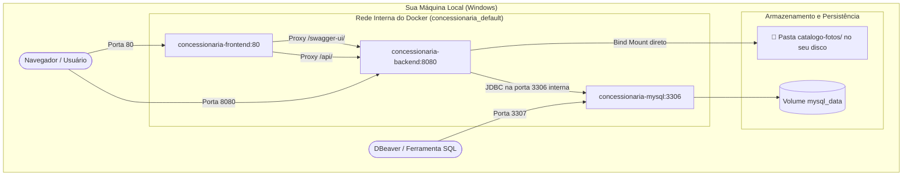

# 🐳 Guia Prático de DevOps, Docker & Comandos — Concessionária Gomez

Este documento foi elaborado para servir como material de consulta permanente no seu **Segundo Cérebro** (compatível com **Obsidian**, incluindo *Callouts*, diagramas *Mermaid* e tabelas de consulta rápida).

---

## 📑 Sumário
1. [Visão Geral da Arquitetura em Containers](#1-visão-geral-da-arquitetura-em-containers)
2. [Tabela de Consulta Rápida (Cheat Sheet)](#2-tabela-de-consulta-rápida-cheat-sheet)
3. [Como Rodar com 1 Clique (Zero Terminal)](#3-como-rodar-com-1-clique-zero-terminal)
4. [Explicação Detalhada dos Comandos](#4-explicação-detalhada-dos-comandos)
5. [Tabela de Portas e Endereços de Acesso](#5-tabela-de-portas-e-endereços-de-acesso)
6. [Persistência de Dados e Cuidados Críticos](#6-persistência-de-dados-e-cuidados-críticos)
7. [Resolução de Problemas (Troubleshooting)](#7-resolução-de-problemas-troubleshooting)

---

## 1. Visão Geral da Arquitetura em Containers

Antes de rodar os comandos, é útil entender como os 3 containers conversam entre si na mesma rede interna criada pelo Docker Compose:



---

## 2. Tabela de Consulta Rápida (Cheat Sheet)

Copie e cole os comandos diretamente no seu terminal (PowerShell ou Bash):

| O que você quer fazer? | Comando | Explicação Rápida |
| :--- | :--- | :--- |
| 🚀 **Subir tudo do zero** | `docker compose up -d` | Sobe Banco, Back e Front em segundo plano. |
| 🔄 **Recompilar e subir** | `docker compose up -d --build` | Use sempre que alterar código Java ou TypeScript/React. |
| 🛑 **Parar tudo** | `docker compose down` | Desliga os containers **sem apagar** seus dados ou fotos. |
| ⏸️ **Pausar temporariamente** | `docker compose stop` | Pausa os containers sem remover a estrutura da rede. |
| ▶️ **Retomar pausa** | `docker compose start` | Religá-los de onde pararam em menos de 1 segundo. |
| 📋 **Ver status dos containers** | `docker compose ps` | Mostra quais containers estão rodando, portas e saúde. |
| 📜 **Ver logs de tudo ao vivo** | `docker compose logs -f` | Acompanha a saída de todos os containers (sair com `Ctrl + C`). |
| ☕ **Ver logs só da API Java** | `docker compose logs -f backend` | Útil para debugar exceções, queries SQL ou inicialização. |
| ⚛️ **Ver logs só do Frontend** | `docker compose logs -f frontend` | Mostra requisições HTTP e erros do Nginx. |
| 🗄️ **Ver logs só do MySQL** | `docker compose logs -f mysql` | Mostra inicialização e conexões do banco de dados. |
| ⚠️ **Apagar TUDO (Reset Geral)** | `docker compose down -v` | **CUIDADO!** Apaga o volume persistente do banco MySQL. |

---

## 3. Como Rodar com 1 Clique (Zero Terminal)

Você **não precisa usar o terminal** no seu dia a dia se preferir uma experiência puramente visual:

### 🖱️ Método A: 1 Clique no IntelliJ (Docker Compose Integrado)
1. No IntelliJ IDEA, abra o arquivo `docker-compose.yml`.
2. Na primeira linha (ao lado da palavra `services:`), você verá um **ícone duplo de Play verde (▶️▶️)** na margem esquerda.
3. Clique nele! O IntelliJ inicia o MySQL, o Backend e o Frontend automaticamente.
4. Uma aba chamada **Services** abrirá no rodapé: nela você tem botões gráficos de Play, Pause, Stop, Restart e visualizador de logs ao vivo de cada serviço.

### 🖱️ Método B: 1 Clique no Docker Desktop
1. Abra o aplicativo **Docker Desktop** no Windows.
2. Na aba **Containers**, localize o grupo **concessionaria**.
3. Clique no botão de **Play (▶️)** para ligar tudo, ou **Stop (⏹️)** para parar.
4. Clique no link azul `80:80` da linha do frontend para abrir a aplicação web direto no navegador.

### 🖱️ Método C: Modo de Desenvolvimento Interativo no IntelliJ (Para Programar)
*Quando você quiser alterar código Java e usar o Debugger com breakpoints:*
1. No Docker Desktop, dê Play apenas no container `concessionaria-mysql`.
2. No IntelliJ, abra `ConcessionariaApiApplication.java` e clique no botão verde de **Run (▶️)** ou **Debug (🪲)**.
3. No arquivo `frontend/package.json`, clique na setinha verde **(▶️)** ao lado de `"dev"` para rodar o Vite diretamente dentro da aba Run do IntelliJ.

---

## 4. Explicação Detalhada dos Comandos

### 🔹 1. Subindo o Sistema
```powershell
docker compose up -d
```
* **O que faz:** Cria a rede interna, monta os volumes de disco, inicia o MySQL, aguarda o teste de saúde (`healthcheck`) do banco ficar verde e, em seguida, sobe a API Spring Boot e o Frontend Nginx.
* **A flag `-d` (*detached*):** Roda os containers em segundo plano, liberando o seu terminal imediatamente para você continuar trabalhando. Se você omitir o `-d`, os logs ocuparão o terminal e se você der `Ctrl + C` os containers serão desligados.

---

### 🔹 2. Atualizando após Alterações de Código
```powershell
docker compose up -d --build
```
* **Quando usar:** Sempre que você fizer alterações em arquivos `.java`, dependências do `pom.xml`, componentes React (`.tsx`) ou no `nginx.conf`.
* **A flag `--build`:** Força o Docker a reconstruir as imagens antes de subir os containers, garantindo que o seu novo código seja empacotado. Sem essa flag, o Docker usaria a imagem antiga gerada anteriormente.

---

### 🔹 3. Parando a Aplicação
```powershell
docker compose down
```
* **O que faz:** Para a execução dos containers com segurança (enviando sinal `SIGTERM` para o Spring Boot e MySQL finalizarem transações abertas) e remove os containers e a rede temporária.
* **Segurança:** **NENHUM dado é perdido!** Os clientes, carros, vendas e fotos continuam intactos no banco (`mysql_data`) e na pasta local (`catalogo-fotos/`).

---

### 🔹 4. Acompanhando Logs de Execução
```powershell
docker compose logs -f backend
```
* **A flag `-f` (*follow*):** Deixa o log "aberto" e atualizando em tempo real conforme requisições chegam na API.
* Para sair da visualização do log sem parar o container, pressione `Ctrl + C`.
* Se quiser ver as últimas 50 linhas de um container:
  ```powershell
  docker compose logs --tail=50 backend
  ```

---

## 5. Tabela de Portas e Endereços de Acesso

Com os containers ligados (`docker compose up -d`), você pode acessar cada componente pelas seguintes URLs no navegador ou ferramentas:

| Recurso | Endereço (URL) | Descrição |
| :--- | :--- | :--- |
| 🌐 **Painel da Concessionária** | [http://localhost](http://localhost) | Aplicação web completa (React + Tailwind) servida na porta padrão 80. |
| 📖 **Swagger UI (Documentação)** | [http://localhost/swagger-ui/index.html](http://localhost/swagger-ui/index.html) | Interface OpenAPI para testar endpoints interativamente. |
| ⚡ **API Spring Boot (Direta)** | [http://localhost:8080/dashboard](http://localhost:8080/dashboard) | Acesso direto aos endpoints RESTful da API. |
| 🗄️ **Banco de Dados MySQL** | `localhost:3307` | Conexão para DBeaver / DataGrip (`root` / `catita01`). |

---

## 6. Persistência de Dados e Cuidados Críticos

> [!IMPORTANT]
> **Onde meus dados ficam gravados?**
> - **Clientes, Carros, Vendas e Metadados das Fotos:** Ficam no volume Docker `mysql_data`, apontado para `/var/lib/mysql`.
> - **Arquivos físicos das Fotos (JPEGs/PNGs):** Ficam espelhados diretamente na pasta física `./catalogo-fotos` do seu projeto no Windows (`C:\Projetos\concessionaria\catalogo-fotos`) via *bind mount* (`./catalogo-fotos:/app/catalogo-fotos`).
> - **Vantagem total:** As fotos que você sobe pelo Docker aparecem imediatamente na pasta do seu Windows e vice-versa; alternar entre rodar pelo IntelliJ e rodar pelo Docker mantém exatamente as mesmas fotos!

> [!CAUTION]
> **Atenção com a flag `-v`!**
> O comando:
> ```powershell
> docker compose down -v   # ❌ CUIDADO: O "-v" (volumes) destrói o banco de dados MySQL!
> ```
> Use o `-v` **apenas** quando você quiser propositalmente resetar o banco de dados do zero para recriar as tabelas pelo Flyway. No dia a dia, use apenas `docker compose down`.

---

## 7. Resolução de Problemas (Troubleshooting)

### Problema 1: "Port 80 is already in use"
Se outra aplicação na sua máquina (ex: IIS, Skype ou outro servidor web) estiver usando a porta 80:
1. Abra o arquivo `docker-compose.yml`.
2. Na seção do `frontend`, troque `ports: - "80:80"` por `ports: - "3000:80"` ou `ports: - "5173:80"`.
3. Suba novamente com `docker compose up -d`. O painel passará a responder em `http://localhost:3000`.

### Problema 2: Preciso rodar comandos direto dentro do container do banco
Para abrir o terminal do MySQL interativo via linha de comando:
```powershell
docker exec -it concessionaria-mysql mysql -u root -pcatita01 concessionaria
```

### Problema 3: O container do Spring Boot não consegue falar com o banco
O Docker Compose cria uma rede com DNS interno. Dentro do container da API, o endereço do banco **não é `localhost`**, e sim o nome do serviço `mysql`:
```properties
DB_URL=jdbc:mysql://mysql:3306/concessionaria
```
Isso já está configurado automaticamente como variável de ambiente no seu `docker-compose.yml`.
